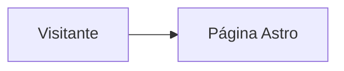

# Diseño · [Nombre de la funcionalidad]

## Resumen
[Visión general de la solución y decisiones principales con su porqué.]

## Arquitectura
[Cómo encaja en el sitio: páginas estáticas, islas de React, rutas `/api/*`, servicios externos.]

## Componentes e interfaces
[Archivos nuevos o modificados, props, funciones y contratos entre ellos.]

## Modelos de datos
[Esquemas zod, tablas, JSON de contenido y sus relaciones.]

## Manejo de errores
[Qué puede fallar, qué ve la persona y cómo se recupera.]

## Estrategia de pruebas
[`npm run check`, build, pruebas unitarias o revisión en navegador en computadora y celular.]

## Integración con CI/CD
[Cambios en `.github/workflows/`, variables de entorno o configuración de hosting.]
