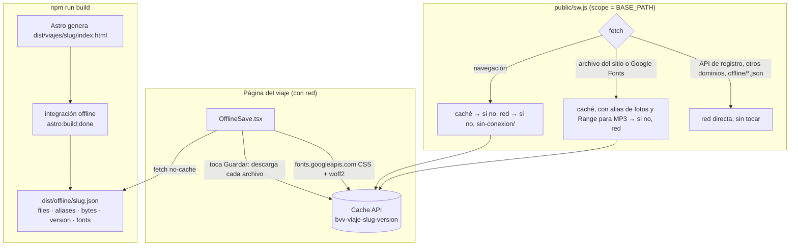
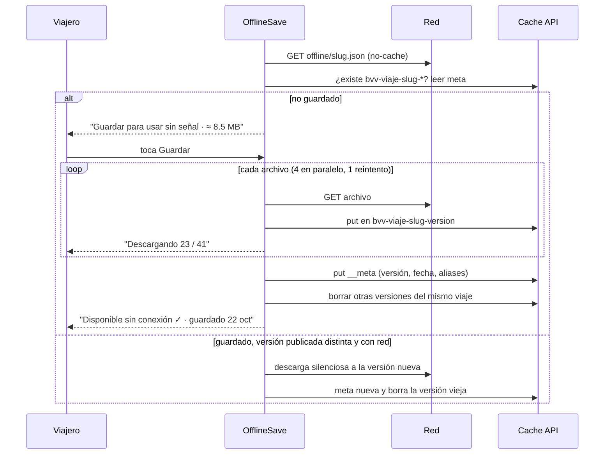

# Diseño · Viaje sin conexión

## Resumen

Tres piezas, sin dependencias nuevas:

1. **En el build**, una integración de Astro (`src/integrations/offline.ts`) lee el HTML ya generado de cada viaje y escribe `dist/offline/<slug>.json` con la lista exacta de archivos que esa página necesita, su peso y una versión (hash del contenido).
2. **En la página**, una isla `OfflineSave.tsx` descarga esa lista a la Cache API cuando el viajero toca "Guardar para usar sin señal", muestra el avance y el estado, y la mantiene al día.
3. **En el navegador**, un service worker chico (`public/sw.js`) que solo *sirve* lo guardado: no descarga paquetes ni decide versiones.

### Decisiones y su porqué

| Decisión | Por qué |
| --- | --- |
| La descarga la hace la isla, no el service worker | Es más fácil mostrar el avance, reintentar y reportar errores desde la página. El SW queda en ~120 líneas sin lógica de versiones y es fácil de razonar. Basta con la Cache API, que también existe en `window`. |
| Lista generada desde el HTML construido, no desde el contenido | Incluye lo que de verdad usa la página (chunks de las islas, CSS, fondos en `url()`, MP3 que sí existen), aunque cambien los componentes. Cumple 6.2 sin mantener listas a mano. |
| Solo la variante más grande de cada foto, con alias | Guardar las 4 tallas del `srcset` pesa ~12 MB. Un celular con DPR 2–3 pide casi siempre la de 1200 px, que además es la del visor (`data-full`). Se guarda esa sola y el SW responde cualquier otra talla de la misma foto con la guardada. Paquete de Tepoztlán: **≈ 8.5 MB** (5.5 MB de audio, 2.8 MB de fotos, 0.3 MB de código). |
| Una caché por viaje y versión: `bvv-viaje-<slug>-<version>` | "Quitar del teléfono" equivale a borrar las cachés de ese viaje. Una actualización escribe la versión nueva completa y después borra la vieja, así nunca queda un HTML nuevo apuntando a archivos que faltan. |
| Las actualizaciones las dispara la isla al abrir la página con red | Cumple 4.1 y 4.2 sin lógica de versiones en el SW: la página guardada se muestra al instante y, si la versión publicada es otra, la isla descarga la nueva en segundo plano. |
| SW registrado solo en producción | En `npm run dev` no hay `dist/offline/*.json` y un SW en desarrollo sirve versiones viejas. Se prueba con `npm run build && npm run preview`. |
| Manifest por viaje | En la página de un viaje, el `start_url` del manifest es esa misma página, así el ícono abre el viaje y no la portada (5.3). El resto del sitio usa el manifest general. |

### Hallazgos de la investigación

- **iPhone: el ícono de la pantalla de inicio tiene su propio almacenamiento**, separado del de Safari (WebKit aísla el almacenamiento de las web apps instaladas). Lo guardado en Safari no se ve desde el ícono y viceversa. Por eso, en iPhone la isla recomienda **primero agregar a inicio y después guardar desde el ícono**, y si detecta que corre como app instalada (`display-mode: standalone`) muestra el botón de guardar normalmente.
- **Safari pide el audio por rangos** (`Range: bytes=…`) y no reproduce, o no deja adelantar, si el SW responde `200` con el archivo completo. El SW recorta el MP3 guardado y responde `206 Partial Content` con `Content-Range` (2.2).
- **Safari borra el almacenamiento de un sitio sin visitas en 7 días** (ITP). No afecta a un viaje que se guarda 1–2 días antes, y las apps instaladas en inicio quedan exentas. Además se pide `navigator.storage.persist()` al guardar (Chrome lo respeta).
- **GitHub Pages manda `Cache-Control: max-age=600`**, así que la isla descarga con `cache: 'no-cache'` para no guardar copias viejas del caché HTTP.
- Google Fonts devuelve un CSS distinto según el navegador. Por eso no se pre-calcula en el build: la isla pide el CSS desde el teléfono del viajero, lo guarda y guarda también los `.woff2` que menciona (ambos dominios permiten CORS).
- Astro genera el HTML del viaje antes de que la integración calcule el peso. La página no sabe su peso al renderizar y la isla lo lee del JSON al cargar ("≈ 8.5 MB" aparece un instante después).

## Arquitectura



### Flujo de guardar y actualizar



## Componentes e interfaces

### Nuevos

**`src/integrations/offline.ts`** · integración de Astro, registrada en `astro.config.mjs`.
- Hook `astro:build:done({ dir })`. Para cada `dist/viajes/<slug>/index.html` (excluye `dist/viajes/index.html`):
  - Extrae URLs del mismo sitio de `src`, `href` (solo `<link rel="stylesheet|icon|manifest|apple-touch-icon">`), `data-full`, `component-url`, `renderer-url`, `before-hydration-url`, `url(...)` en estilos en línea y rutas `audioguias/…mp3` dentro de `props` de `<astro-island>`.
  - En `srcset` toma solo el candidato más ancho y registra un alias de cada talla hacia ese.
  - Recorre los `.js` encontrados siguiendo sus `import … from "./x.js"` (chunks compartidos como `react.*.js` y `jsx-runtime.*.js`), y los `.css` siguiendo sus `url()`.
  - Agrega `sin-conexion/` y sus archivos, `favicon.svg`, el manifest del viaje y los íconos.
  - Toma las URLs de `https://fonts.googleapis.com/css2?...` como `fonts`.
  - Descarta lo que no exista en `dist`, suma los bytes y calcula `version` = primeros 12 caracteres del SHA-256 de todos los archivos en orden.
- Todas las URLs ya llevan `BASE_PATH`, porque se leen del HTML construido.

**`src/components/islands/OfflineSave.tsx`** · `client:idle`. Props: `slug: string`, `jsonUrl: string`, `title: string`.
- No renderiza nada si faltan `serviceWorker` o `caches`, o si `import.meta.env.DEV` (1.7).
- Estados: `cargando` → `listo-para-guardar` | `descargando {hechos,total}` | `guardado {fecha}` | `actualizando` | `error`.
- Botones y textos:
  - "Guardar para usar sin señal · ≈ X MB"
  - "Descargando 23 / 41" con barra de filete
  - "Disponible sin conexión ✓ · guardado 22 oct"
  - "Quitar del teléfono" (4.4)
  - "Reintentar"
- Nota fija: "Mapas, WhatsApp y registro necesitan señal" (3.2).
- Aviso "Sin conexión · usando la copia guardada" según `navigator.onLine` y los eventos `online`/`offline` (3.1, 3.3).
- Tras guardar sugiere agregar a inicio (5.2):
  - iPhone: "Compartir → Agregar a inicio".
  - Android: botón con `beforeinstallprompt` si llega; si no, "Menú ⋮ → Instalar app".
  - En iPhone fuera de standalone se aclara: "Ábrela desde el ícono con señal y toca Guardar ahí también".
- `aria-live="polite"` en el estado y botones nativos (6.3).

**`src/lib/offline.ts`** · lógica sin React, para que la isla quede delgada:
- `cacheName(slug, version)`, `findSaved(slug): Promise<{ version, savedAt } | null>`.
- `saveTrip(json, onProgress, signal?)`: descarga a la caché nueva con concurrencia 4, `cache: 'no-cache'` y 1 reintento por archivo. Incluye el CSS de Google Fonts y sus `woff2`. Al terminar escribe `__meta` y borra las versiones anteriores. Si algo falla, borra la caché a medias y lanza un error (1.6).
- `removeTrip(slug)`, `requestPersist()`.

**`public/sw.js`** · service worker clásico (sin módulos, para Safari):
- `install`: `skipWaiting()`. `activate`: `clients.claim()`. No precarga nada (1.8).
- `BASE` = `new URL(self.registration.scope).pathname`.
- `fetch` solo para `GET`:
  - **Pasa directo a la red**, sin interceptar: cualquier origen distinto del sitio y de `fonts.googleapis.com`/`fonts.gstatic.com` (incluida la API de Apps Script, 6.4), además de `BASE + 'offline/'`, `sw.js` y las páginas no guardadas cuando hay red.
  - **Navegaciones**: `caches.match(req, { ignoreSearch: true })` en las cachés `bvv-viaje-*`. Si está guardada, responde desde la caché (4.1). Si no, va a la red y, si falla, responde `sin-conexion/` de cualquier caché o un `Response` de texto mínimo (2.5).
  - **Archivos**: busca en las cachés. Si no está y es una foto, consulta los `aliases` de los `__meta` y responde con la variante guardada (2.4). Si tampoco, va a la red (4.3).
  - **Range**: si la petición trae `Range` y hay copia guardada, responde `206` con el segmento del `blob()` (2.2).

**`src/pages/sin-conexion.astro`** · página con `Base`, `noindex` y fuera del sitemap. Un script en línea lee las cachés `bvv-viaje-*` y su `__meta` (título y URL) y lista "Tus viajes guardados" con enlaces. Si no hay ninguno: "Abre la página de tu viaje con señal y toca Guardar".

**`src/pages/manifest.webmanifest.ts`** y **`src/pages/viajes/[slug]/manifest.webmanifest.ts`** · endpoints como `robots.txt.ts`, que respetan `BASE_URL`:
- `name: "Bebe, Vive, Viaja"` y `short_name: "BVV"`; en el de viaje, `name: "<título> · BVV"`.
- `start_url` y `scope`: `BASE` para el general; la página del viaje para el de viaje (5.3).
- `display: "standalone"`, `background_color: "#121417"`, `theme_color: "#121417"` y los íconos.

**`public/icons/`** · `icon-192.png`, `icon-512.png`, `icon-maskable-512.png` y `apple-touch-icon.png` (180). Se generan una vez con un script (`scripts/iconos.mjs`, que usa `sharp`, ya instalado por Astro): el mandala blanco centrado sobre `#121417`. Los PNG quedan en el repo.

### Modificados

- **`src/layouts/Base.astro`**:
  - Nueva prop opcional `manifest` (por defecto el general).
  - `<link rel="manifest">`, `<link rel="apple-touch-icon">` y `<meta name="apple-mobile-web-app-capable">`.
  - Solo en producción, un script en línea que registra `url('/sw.js')` con `{ scope: url('/') }`.
- **`src/pages/viajes/[slug].astro`**:
  - Pasa `manifest={url(`/viajes/${viaje.id}/manifest.webmanifest`)}`.
  - Monta `<OfflineSave client:idle …/>` en una franja `.offline` entre el índice de capítulos (`.toc`) y la audioguía del tour: filete superior e inferior, etiqueta mono y el botón `.btn` existente.
- **`astro.config.mjs`**: agrega la integración y excluye `/sin-conexion/` del sitemap.
- **`src/components/Lightbox.astro`**: sin cambios. El alias del SW cubre `data-full`, que ya es la variante guardada.

## Modelos de datos

`dist/offline/<slug>.json` (generado; no está en `src/`):

```ts
interface OfflineBundle {
  slug: string;            // "tepoztlan-2026-10"
  title: string;           // "Tepoztlán & Skydive"
  page: string;            // "/bebe-vive-viaja/viajes/tepoztlan-2026-10/"
  version: string;         // "a1b2c3d4e5f6"
  bytes: number;           // suma de files (sin fuentes)
  files: string[];         // URLs del sitio, con BASE_PATH
  aliases: Record<string, string>; // talla de srcset → variante guardada
  fonts: string[];         // CSS de Google Fonts
}
```

Entrada `__meta` dentro de cada caché (`Response` JSON en `BASE + '__meta/<slug>'`):

```ts
interface SavedMeta { slug: string; title: string; page: string; version: string; savedAt: string; aliases: Record<string, string> }
```

No cambia el esquema zod de viajes: todo sale del HTML construido.

## Manejo de errores

| Qué falla | Qué ve el viajero | Recuperación |
| --- | --- | --- |
| Un archivo no descarga (señal mala) | Tras 1 reintento: "No se pudo guardar todo, intenta con wifi" + "Reintentar" | Se borra la caché a medias; la versión anterior, si había, sigue intacta (1.6) |
| Sin espacio (`QuotaExceededError`) | "Tu teléfono no tiene espacio para guardar este viaje (≈ X MB)" | Igual que arriba |
| Toca Guardar dos veces | El botón queda deshabilitado mientras descarga (1.3) | — |
| No existe `offline/<slug>.json` (dev o build viejo) | El control no aparece | — |
| Falla la actualización silenciosa | Nada; sigue la copia anterior | Se reintenta la siguiente vez que abra la página con red |
| Abre una página no guardada sin red | `sin-conexion/` con sus viajes guardados | Si `sin-conexion/` tampoco está guardada, un texto plano "Sin conexión" |
| Fallan las fuentes de Google | No bloquea el guardado: se marca como guardado y se usan las fuentes del sistema | Se reintenta en la siguiente actualización |
| El SW falla al registrarse | El sitio funciona como hoy; el control dice "Este navegador no permite guardar la página" | — |
| El navegador borró la caché (ITP o falta de espacio) | El control vuelve a "Guardar para usar sin señal" | Volver a guardar |

## Estrategia de pruebas

- `npm run check` y `npm run build` sin errores (6.5).
- Revisión del JSON generado: `dist/offline/tepoztlan-2026-10.json` incluye los 6 MP3, los chunks `react`/`jsx-runtime`, los dos CSS, la portada `vista.*.webp`, el mandala y una sola variante por foto, con un peso de ~8–9 MB. `fig-leon-2026-11` también genera su JSON.
- Con `npm run preview` y `BASE_PATH=/bebe-vive-viaja` en el navegador del panel:
  1. Guardar y ver el avance → "Disponible sin conexión ✓". Revisar que `caches.keys()` tenga `bvv-viaje-tepoztlan-2026-10-<version>`.
  2. Detener `preview` (sin red real) y recargar: la página carga completa, las fotos se ven, el checklist marca, el visor abre, aparece el aviso de sin conexión y una audioguía suena y se puede adelantar.
  3. Abrir `/` sin red → `sin-conexion/` con el enlace a Tepoztlán.
  4. Cambiar un texto del JSON, reconstruir y abrir con red → la versión se actualiza sola. En la siguiente apertura sin red se ve el texto nuevo.
  5. "Quitar del teléfono" → la caché desaparece y el botón vuelve a "Guardar".
  6. Con red, `/bienvenida/` sigue llamando a la API sin pasar por el SW (pestaña de red).
- En celulares reales, ya publicado en GitHub Pages:
  - iPhone en Safari: guardar, activar modo avión y abrir.
  - iPhone con el ícono: agregar a inicio, guardar desde el ícono, activar modo avión y abrir.
  - Android en Chrome: lo mismo e instalar.
  - Esta prueba la haces tú. El panel de navegador no emula iOS.

## Integración con CI/CD

- Sin cambios en `.github/workflows/pages.yml`: la integración corre dentro de `npm run build` y ya recibe `BASE_PATH` y `SITE_URL`.
- `public/sw.js` se publica en `BASE/sw.js`. GitHub Pages no permite el header `Service-Worker-Allowed`, por eso el alcance es exactamente `BASE` (el SW vive en esa carpeta y no necesita más).
- Los navegadores revisan `sw.js` en cada navegación (máximo cada 24 h). Como el SW no tiene versión de contenido, casi nunca cambia. Cuando cambie, se actualiza solo con `skipWaiting` y `clients.claim`.
- Cloudflare a futuro: funciona igual con `BASE_PATH` vacío.
