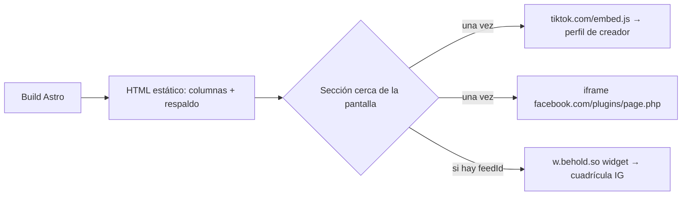

# Diseño · Redes sociales en el sitio

## Resumen

Una sección nueva `Siguenos.astro` en la portada, entre los viajes y el cierre, con tres columnas (Instagram, TikTok, Facebook). Cada columna trae su HTML de respaldo desde el build (enlace al perfil) y un hueco donde un script pequeño monta el embed de la red cuando la sección se acerca a la pantalla. Mockup aprobado: https://claude.ai/artifact/9aBMGLVVum24dpemPnvACJ

Decisiones:
- **Carga al acercarse, no con clic:** el objetivo es que el perfil se vea. `IntersectionObserver` con margen de 400 px mantiene la portada ligera (3.1, 3.2).
- **Script propio en `.astro`, sin React:** no hay estado de UI, solo insertar scripts e iframes una vez (convención del proyecto).
- **Instagram por widget de Behold:** no hay embed oficial de perfil. Mientras no exista el ID del feed se muestra la tarjeta de respaldo (2.5).

## Arquitectura



## Componentes e interfaces

- `src/config/site.ts`: `instagramFeedId` (vacío hasta que exista) junto a `instagram`, `facebook`, `tiktok`; `socials` ya expone las URLs limpias.
- `src/components/Siguenos.astro`: encabezado (etiqueta "Comunidad", título "Síguenos *en el camino*", texto) y grid de 3 columnas (1 en celular). Cada columna: etiqueta numerada, enlace "Abrir ↗" siempre visible (3.3) y un `.embed` con `data-embed="tiktok|facebook|instagram"`.
  - TikTok: `<blockquote class="tiktok-embed" data-embed-type="creator" …>` con enlace dentro; `embed.js` lo convierte.
  - Facebook: `<iframe data-src="…/plugins/page.php?href=…&tabs=timeline&adapt_container_width=true">` sin `src` hasta cargar.
  - Instagram: `<behold-widget feed-id>` si hay ID; si no, tarjeta con avatar, usuario y botón "Seguir en Instagram".
- `src/pages/index.astro`: monta `<Siguenos />` después de "Viajes anteriores".

## Modelos de datos

Sin contenido nuevo. Configuración en `site.ts`:

```ts
instagram: 'bebeviveviaja', instagramFeedId: '', facebook: 'bebeviveviaja', tiktok: 'bebeviveviajamx'
```

## Manejo de errores

- El enlace "Abrir ↗" y el contenido de respaldo están en el HTML; si un script falla o lo bloquean, la columna sigue siendo útil.
- Contenedores con `max-width: 100%` y `overflow: hidden` para que ningún embed rompa el ancho en celular (3.4).
- El observador se desconecta tras la primera carga; los scripts se insertan una sola vez.

## Estrategia de pruebas

- `npm run check` y `npm run build`.
- En el navegador: la red no pide nada de tiktok/facebook/behold al cargar arriba (3.1); al bajar a la sección sí (3.2); sin scroll horizontal a 375 px (3.4).
- Revisión visual en computadora y celular contra el mockup.

## Integración con CI/CD

Sin cambios: `pages.yml` construye y publica. El ID de Behold no es secreto (va en el HTML), vive en `site.ts`.
