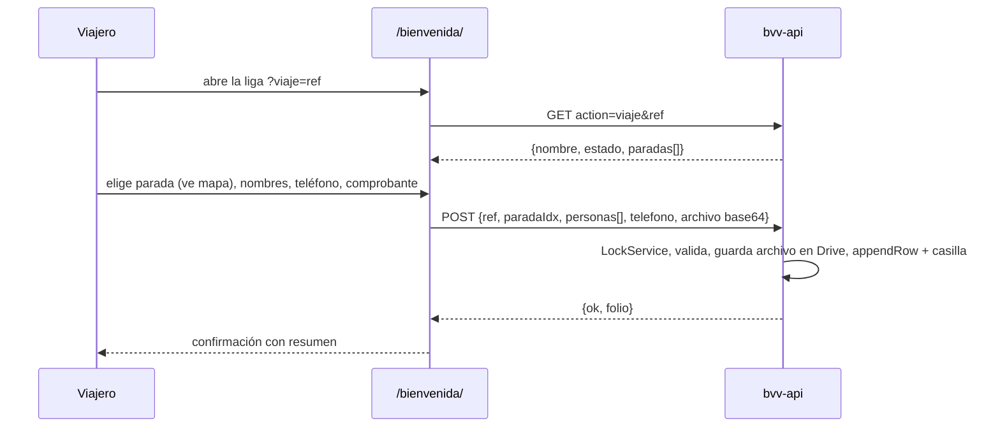

# Diseño · Registro de viajeros con Google Sheets

## Resumen

Tres piezas:

1. **Página pública `/bienvenida/?viaje=<ref>`** (Astro + una isla de React). Muestra la bienvenida con el nombre del viaje, el formulario de registro (parada con mapa, nombres, teléfono, comprobante) y abajo las políticas de cancelación con el PDF.
2. **API en Apps Script** (`bvv-api`): aplicación web pública que lee viajes y paradas y guarda registros y comprobantes en Drive.
3. **Admin en Apps Script** (`bvv-admin`): aplicación web con acceso "Solo yo". Sirve para dar de alta viajes, crear sus pestañas, cerrar viajes y compartir la liga.

Mockup: https://claude.ai/artifact/NwftuUbeVrHZ2Y4GCCuPjL

Las dos aplicaciones de Apps Script trabajan sobre los mismos archivos de la cuenta de la marca: la **hoja de respuestas** (con una pestaña `Viajes` que funciona como registro de viajes) y la **hoja de paradas**.

Decisiones:
- **Dos proyectos de Apps Script, no uno.** El nivel de acceso ("Cualquiera" o "Solo yo") se configura por aplicación web. Si los separamos, la API pública no tiene ninguna ruta de admin y el admin queda protegido por el inicio de sesión de Google, sin claves que se puedan filtrar (2.1).
- **El admin vive en Apps Script, no en el sitio.** Así no hace falta inventar autenticación. El sitio solo contiene páginas públicas.
- **Página nueva `/bienvenida/`.** `/politicas-de-cancelacion/` se queda como liga genérica y sigue siendo la fuente del PDF (6.6). Las políticas pasan a un componente que usan las dos páginas.
- **La referencia va en un parámetro (`?viaje=`), no en la ruta.** Los viajes se crean desde el admin sin volver a publicar el sitio. GitHub Pages solo sirve archivos estáticos, así que la página lee el parámetro en el navegador (6.5).
- **El mapa se embebe sin API key** con `https://maps.google.com/maps?q=<dirección>&output=embed`. Los links de Google Maps que se pegan normalmente (`maps.app.goo.gl/...`) no se pueden embeber. Por eso el mapa siempre se ubica por la dirección y el link se usa para el botón "Abrir en Google Maps" (4.3, 6.4).
- **Formulario en React (`Registro.tsx`).** Tiene estado real (paradas cargadas, lista dinámica de nombres, archivo, envío), así que cumple la convención de "React solo para interacción".

## Arquitectura

```mermaid
flowchart LR
  subgraph Sitio estático · GitHub Pages
    P["/bienvenida/?viaje=ref"] --> R[Isla Registro.tsx]
    P --> PC[PoliticasCancelacion.astro + PDF]
  end
  subgraph "Apps Script · cuenta de la marca"
    API["bvv-api · acceso: Cualquiera"]
    ADM["bvv-admin · acceso: Solo yo"]
  end
  subgraph Google Drive
    HR[(Hoja de respuestas<br/>pestaña Viajes + una por viaje)]
    HP[(Hoja de paradas<br/>una pestaña por viaje)]
    C[[Carpeta Comprobantes / viaje]]
  end
  R -- "GET ?action=viaje&ref=" --> API
  R -- "POST registro (text/plain JSON)" --> API
  API --> HR & HP & C
  O[Organizadora] --> ADM --> HR & HP & C
  ADM -- "Compartir liga" --> W[WhatsApp / portapapeles]
```

Flujo del viajero:



## Componentes e interfaces

### Sitio (Astro)

- `src/components/PoliticasCancelacion.astro` (nuevo): las secciones de políticas de la página actual (pill "por persona", tarjetas cliente/empresa, nota y botón PDF), con sus estilos de pantalla. La versión impresa se queda en la página de políticas.
- `src/pages/politicas-de-cancelacion.astro`: usa el componente. Sigue con su bienvenida genérica y su CSS de impresión. El PDF no cambia.
- `src/pages/bienvenida.astro` (nuevo): portada "Te damos la Bienvenida", con un `<span data-viaje-nombre>` que la isla rellena. Después vienen `<Registro client:load api={site.registroApi} />` y `<PoliticasCancelacion />`. Lleva `noindex` y se excluye del sitemap, igual que la página de políticas.
- `src/components/islands/Registro.tsx` (nuevo):
  - Lee `?viaje=` con `URLSearchParams`. Sin referencia: muestra el aviso de 6.1 y no hace la petición.
  - Estados: `cargando → listo | sinViaje | cerrado | sinParadas | error`, y en el envío `enviando → enviado | errorEnvio`.
  - Pasos numerados con el estilo de la página (01, 02, 03):
    - **01 Punto de abordaje:** lista de radio con nombre y dirección. Al elegir una parada se muestra el `<iframe>` del mapa (con `loading="lazy"`) y el enlace "Abrir en Google Maps".
    - **02 Quiénes viajan:** un campo por persona, con "+ Agregar persona" y "Quitar". También pide el teléfono a 10 dígitos.
    - **03 Comprobante:** `<input type="file" accept="image/*,application/pdf">`. Las fotos de más de 2 MB se reducen con `<canvas>` a 2000 px de lado mayor (JPEG al 85 %) antes de enviarse, para que suban rápido desde el celular.
  - **Guardar:** valida (4.5) y se deshabilita mientras envía (4.8). Si falla, conserva los datos y ofrece reintentar (4.9).
  - Al terminar actualiza `document.title` y `[data-viaje-nombre]` con el nombre del viaje.
- `src/config/site.ts`: `registroApi: ''` con la URL `/exec` de `bvv-api`. Es pública y no es secreto.
- `src/lib/registro.ts` (nuevo): tipos compartidos (`ViajePublico`, `Parada`, `RegistroPayload`, `RegistroRespuesta`) y `fetchViaje` y `enviarRegistro`. **Si `registroApi` está vacío y es modo dev, usa datos de prueba** (`src/lib/registro-mock.ts`) para poder trabajar sin Google.
- `astro.config.mjs`: el filtro del sitemap también excluye `/bienvenida/`.

### API · `apps-script/api/` (Apps Script, acceso "Cualquiera", se ejecuta como la marca)

- `appsscript.json`: `timeZone: "America/Mexico_City"`, `webapp: { access: "ANYONE_ANONYMOUS", executeAs: "USER_DEPLOYING" }`.
- `Code.gs`:
  - `doGet(e)`: atiende `action=viaje&ref=…` y responde `{ ok, viaje: { ref, nombre, estado, paradas: [{ nombre, direccion, maps }] } }` o `{ ok:false, error:'no_existe' }`. No devuelve URLs de hojas ni IDs de carpetas (2.3).
  - `doPost(e)`: recibe en `e.postData.contents` un JSON enviado como `text/plain`. Así el navegador no hace la petición previa de CORS, que Apps Script no soporta. Pasos:
    1. Valida campos y tamaño (≤ 10 MB ya decodificado) y que el campo trampa contra bots (`sitio`) venga vacío.
    2. Revisa que el viaje exista, esté `abierto` y que la parada exista.
    3. Toma `LockService.getScriptLock()`.
    4. Crea el archivo en la carpeta del viaje como `AAAA-MM-DD_<folio>_<primer-nombre>.<ext>`, con acceso privado.
    5. Agrega la fila e inserta la casilla en la columna de validación.
    6. Responde `{ ok, folio }`.
  - Configuración en *Propiedades del script*: `RESPUESTAS_ID`, `PARADAS_ID`, `CARPETA_COMPROBANTES_ID`.

### Admin · `apps-script/admin/` (Apps Script, acceso "Solo yo")

- `appsscript.json`: `webapp: { access: "MYSELF", executeAs: "USER_DEPLOYING" }`.
- `Code.gs`:
  - `doGet()` sirve `Index.html`.
  - Funciones que llama `google.script.run`:
    - `listarViajes()`: viajes con su número de registros y los enlaces a sus pestañas (1.8).
    - `crearViaje({ nombre, ref })`: valida que la referencia sea única (1.3) y que las hojas existan (1.4). Crea o reutiliza las pestañas en las dos hojas (1.5–1.7) y la subcarpeta de comprobantes. Agrega la fila en `Viajes`.
    - `cambiarEstado(ref, 'abierto'|'cerrado')` (1.9).
    - `ligaDe(ref)`: devuelve `SITE_URL + '/bienvenida/?viaje=' + ref`.
  - Propiedades del script: las mismas tres IDs, más `SITE_URL` (p. ej. `https://andreymartinez.github.io/bebe-vive-viaja`).
- `Index.html`: formulario con el nombre del viaje y la referencia, que se genera sola sin acentos, en minúsculas y con guiones, y se puede editar (1.2). Debajo, la lista de viajes con el estado, el número de registros, enlaces "Paradas ↗" y "Respuestas ↗", un botón para cerrar o reabrir el viaje y el botón **Compartir liga**. Ese botón:
  1. intenta `navigator.share` (3.2);
  2. si no hay menú nativo, copia con `navigator.clipboard` o, como respaldo, `execCommand('copy')` sobre un campo visible, y muestra "Liga copiada" (3.3);
  3. siempre ofrece "Enviar por WhatsApp" (`https://wa.me/?text=…`, que se abre en una pestaña nueva).

  Usa la misma paleta y tipografías del sitio (Google Fonts), sin depender del CSS del sitio.

Los dos proyectos repiten un pequeño `Comun.gs` con los nombres de columnas y funciones de ayuda. Es una copia mínima y documentada: Apps Script no permite compartir código entre proyectos sin publicar una librería.

## Modelos de datos

**Hoja de respuestas · pestaña `Viajes`** (registro de viajes; solo la escribe el admin):

| Referencia | Nombre | Estado | Pestaña | Carpeta | Creado |
|---|---|---|---|---|---|
| `tepoztlan-2026-10` | Tepoztlán · Oct 2026 | abierto / cerrado | nombre de las pestañas | ID de la subcarpeta de comprobantes | fecha |

**Hoja de respuestas · una pestaña por viaje** (4.6):

| Folio | Fecha | Parada | Dirección | Personas | Núm. personas | Teléfono | Comprobante | Comprobante validado |
|---|---|---|---|---|---|---|---|---|
| `BVV-7K3Q` | 22/10/2026 18:05 | Toluca · Plaza Sendero | Av. … | Ana López⏎Luis Pérez | 2 | 5512345678 | enlace al archivo en Drive | ☐ |

- El folio es corto, aleatorio y legible. Sirve para que la organizadora y el viajero hablen del mismo registro.
- "Comprobante validado" es una casilla (`insertCheckboxes`) que el script crea sin marcar y nunca modifica (5.1, 5.2).
- Fila de encabezado congelada y en negritas.

**Hoja de paradas · una pestaña por viaje** (1.5):

| Nombre de parada | Dirección | Link de Google Maps |
|---|---|---|

Las filas sin nombre se ignoran. El orden de la hoja es el orden en pantalla.

**Contratos (TypeScript, `src/lib/registro.ts`):**

```ts
type Parada = { nombre: string; direccion: string; maps: string };
type ViajePublico = { ref: string; nombre: string; estado: 'abierto' | 'cerrado'; paradas: Parada[] };
type RegistroPayload = {
  ref: string; parada: number; personas: string[]; telefono: string;
  archivo: { nombre: string; tipo: string; base64: string }; sitio: ''; // trampa contra bots
};
type RegistroRespuesta = { ok: true; folio: string } | { ok: false; error: string; campo?: string };
```

## Manejo de errores

| Situación | Qué ve el viajero |
|---|---|
| Liga sin `?viaje=` o con una referencia que no existe | Bienvenida genérica, políticas y "Esta liga no corresponde a un viaje. Pide tu liga a quien te vendió el lugar." (6.1) |
| Viaje cerrado | Bienvenida con el nombre del viaje, el aviso "Registro cerrado" y las políticas (6.2) |
| Viaje sin paradas | "Pronto publicaremos los puntos de abordaje", sin botón Guardar (6.3) |
| La API no responde al cargar | "No pudimos cargar tu viaje" con botón Reintentar. Las políticas se siguen viendo |
| Dato inválido | Mensaje junto al campo; no se envía (4.5) |
| Falla al guardar (red, cuota, viaje cerrado mientras llenaba) | Mensaje claro; los datos siguen en el formulario; botón Reintentar (4.9) |

Del lado de Apps Script:
- Todo `doPost` va dentro de `try/catch` y responde JSON con `ok:false` y un código (`campo_invalido`, `viaje_cerrado`, `archivo_grande`, `error_interno`).
- Si falla la fila después de crear el archivo, el archivo se manda a la papelera para no dejar comprobantes huérfanos.
- `LockService` evita que dos registros simultáneos choquen al agregar filas.

Límites conocidos de Apps Script (cuenta gratis): unos 20 000 llamados por día y 6 minutos por ejecución. Sobra para este volumen. Cada guardado tarda entre 1 y 3 segundos, y el botón muestra "Guardando…" mientras tanto.

## Estrategia de pruebas

- `npm run check` y `npm run build`.
- En el navegador, con los datos de prueba en dev:
  - los estados (sin referencia, cerrado, sin paradas, listo);
  - el mapa cambia al elegir otra parada;
  - agregar y quitar personas;
  - las validaciones;
  - no hay doble envío;
  - sin scroll horizontal a 375 px.
- `/politicas-de-cancelacion/` se ve igual que antes y al imprimir sale la misma hoja (6.6).
- Apps Script, con hojas de prueba:
  - crear un viaje en el admin genera las pestañas y la carpeta;
  - crear de nuevo la misma referencia se rechaza;
  - un registro real desde el sitio crea la fila, la casilla y el archivo privado;
  - cerrar el viaje bloquea nuevos envíos;
  - abrir el admin en una ventana de incógnito pide iniciar sesión y rechaza a otra cuenta.

## Integración con CI/CD

- El sitio no cambia de workflow: `pages.yml` publica con cada push. `registroApi` vive en `site.ts`; no es secreto.
- Apps Script no se publica desde GitHub. `apps-script/README.md` explica la instalación una sola vez, copiando y pegando (o con `clasp` si se prefiere):
  1. crear las dos hojas y la carpeta;
  2. crear los dos proyectos;
  3. poner las propiedades del script;
  4. implementar como aplicación web con el acceso indicado;
  5. pegar la URL `/exec` en `site.ts`.

  Cada cambio al código de Apps Script requiere "Nueva implementación" o actualizar la existente. El README lo indica.
